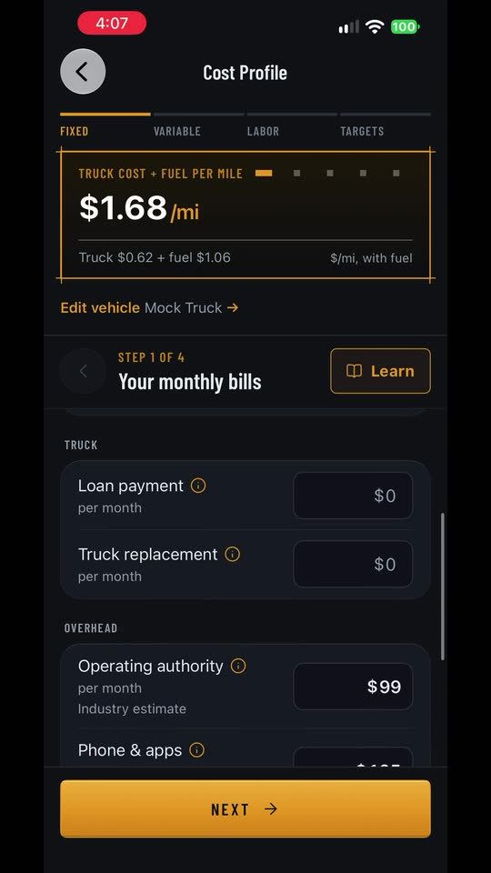
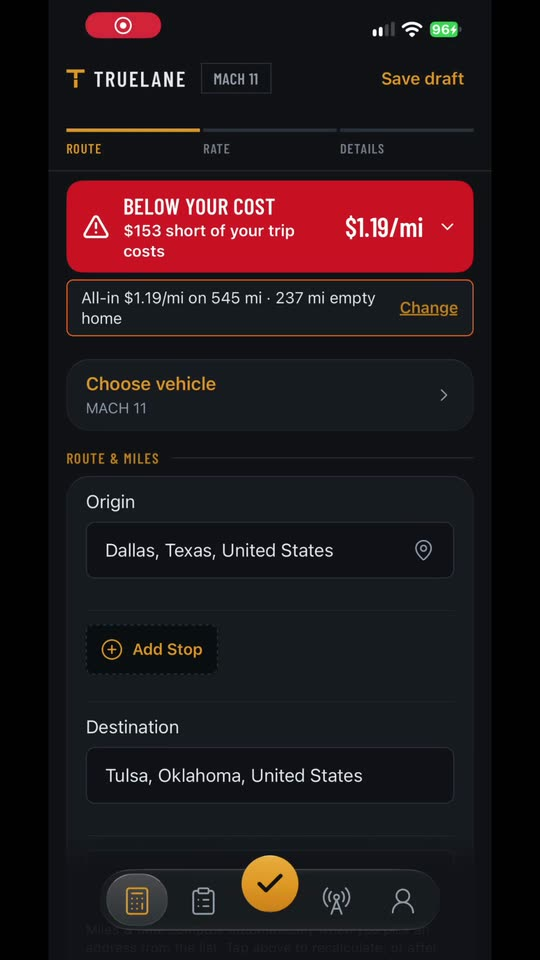
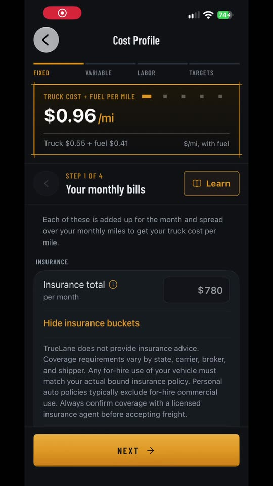
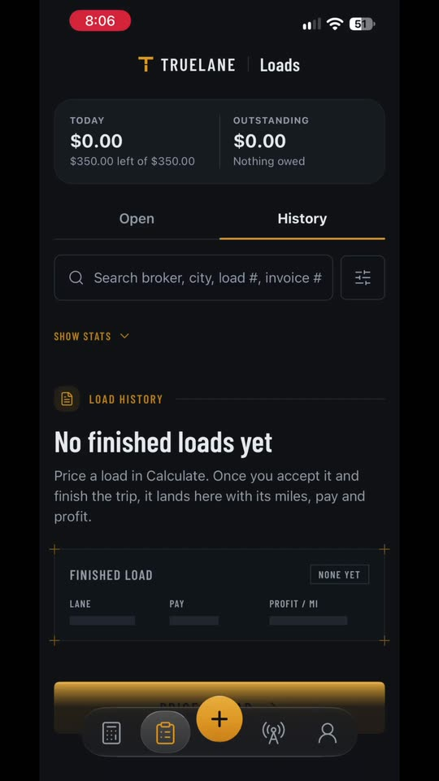
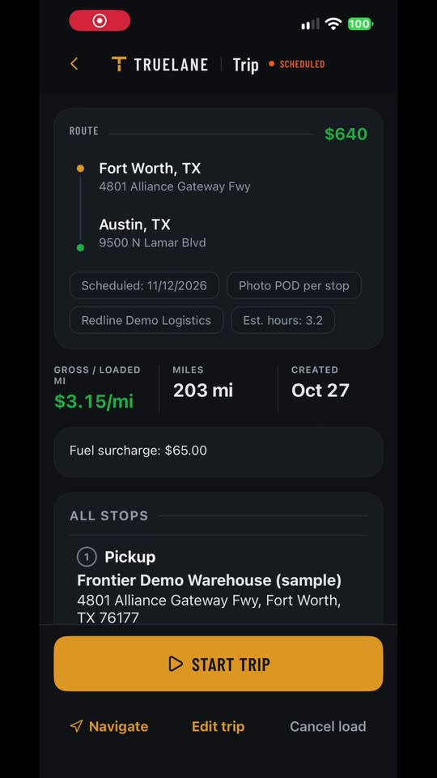
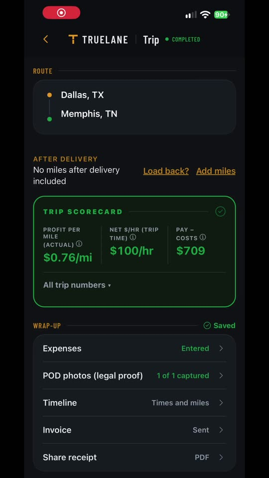
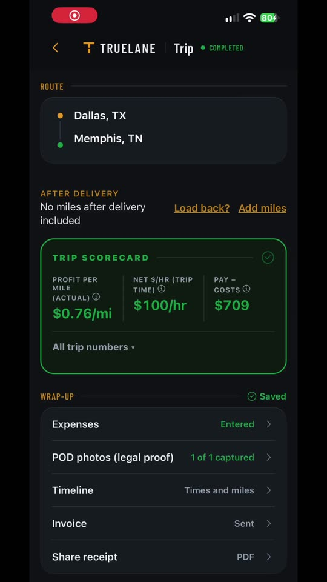
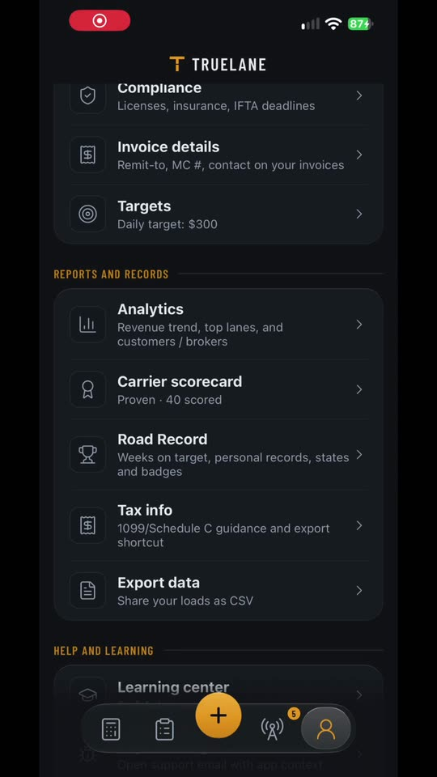

# TrueLane for drivers

**Know your real cost per mile before you say yes to a load.**
A freight-decision app for owner-operators, built in Dallas–Fort Worth and in iOS beta.

[Website](https://truelane-three.vercel.app) · [Watch it work](#watch-it-work) · [The dispatcher desk](https://github.com/christopher-mcdaniel/TrueLane-Dispatch-Desk) · [Contact](#contact)

> **This is a showcase repository.** It shows what the product does, how it is built and what it looks like. The source code is private and is not published here.

---

## The problem

A broker offers a load at a rate. Is it a good rate? Most owner-operators answer from gut feel, because the honest answer depends on things nobody does in their head at the dock: fuel, fixed costs, driver time, and the empty miles to get there and home.

TrueLane answers it in seconds, from the driver's own costs, and keeps working with no signal.

## What it does

| | |
| --- | --- |
| **A verdict on every offer** | Put in the rate and the miles. Get *below your cost*, *at market* or *above*, with the line that explains why. Change an assumption and watch it move. |
| **The deadhead flip** | The same offer can go from below your cost to at market when a load covers the way home. The app shows that, instead of hiding it. |
| **Rate confirmations, read for you** | Photograph or import a rate confirmation. The app reads it, shows a check sheet to confirm, and adds the load to Upcoming. |
| **A trip you can run with one hand** | Next stop, I've arrived, Mark loaded, all stops done. Seal numbers, dock waiting time and proof of delivery along the way. |
| **Your own cost profile** | Four steps to set what your truck really costs to run. Every verdict is made from it. |
| **Invoices from the trip** | The wrap-up goes straight to an invoice you can share. |
| **Scorecards and analytics** | A scorecard for each trip and an analytics view across all of them. |
| **Taxes and records** | The year's totals, a loads CSV export and an audit bundle. |
| **Works offline** | The trip screen keeps working in airplane mode and syncs when the signal returns. |

## Watch it work

Short clips of the real app. Click a still to play the video.

| | | |
| --- | --- | --- |
|  **The deadhead flip** |  **An offer in, a verdict out** |  **Set your truck's costs** |
|  **A rate confirmation, read** |  **Running the trip** |  **Trip to invoice** |
|  **Scorecards and analytics** |  **Taxes and records** | |

## How it is built

- **iOS app in TypeScript** on React Native and Expo.
- **Offline first.** A local database on the phone is the source of truth while driving; a background sync reconciles with the server.
- **Server on Supabase** (Postgres) with row-level security, signed-in accounts and storage for proof-of-delivery photos.
- **Document reading.** A pipeline turns a photographed rate confirmation into structured fields, then asks the driver to confirm what it read before anything is saved.
- **Money math you can check.** The cost and verdict logic is plain, deterministic code covered by an automated audit, not a black box.
- **Careful with data.** Drivers' records stay theirs. Nothing is shared without an explicit choice.

## Status

In beta on iOS (TestFlight), for owner-operators in the US. The same engine powers the [TrueLane Dispatch Desk](https://github.com/christopher-mcdaniel/TrueLane-Dispatch-Desk) for fleets and dispatchers.

## Contact

**Christopher McDaniel** · Founder, Dallas–Fort Worth
Building mobile apps, web products and automations for freight and field businesses.
[LinkedIn](https://www.linkedin.com/in/build-with-chris) · [truelane-three.vercel.app](https://truelane-three.vercel.app) · c.mcdaniel.tx@outlook.com

---

© 2026 TrueLane. All rights reserved. See [LICENSE](LICENSE). The source code is not open source.
